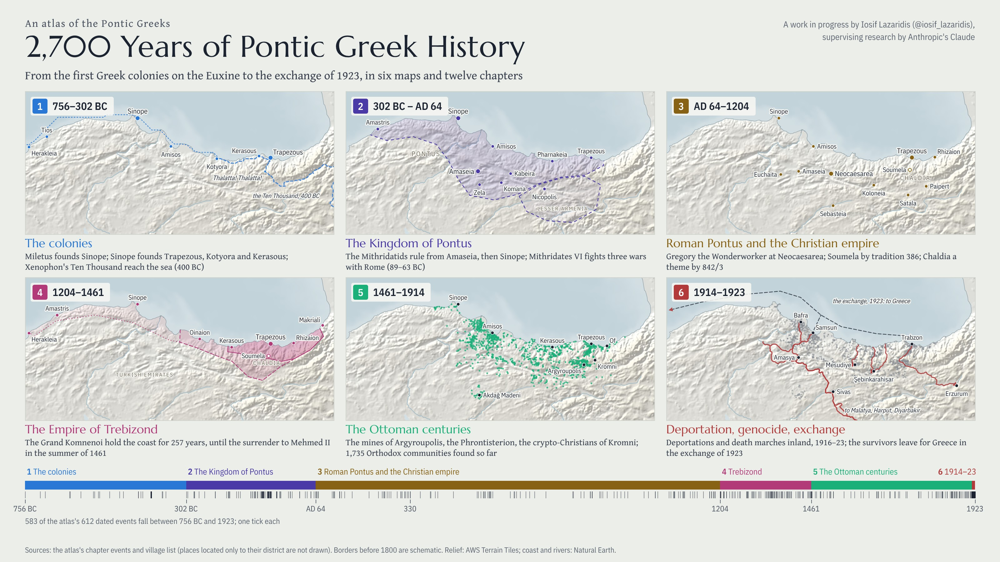

# 2,700 Years of Pontic Greek History

An atlas of the Pontic Greeks, 756 BC to the exchange of 1923.

**Open the atlas:** https://iosiflazaridis.github.io/pontic-greek-history/

The atlas covers the six metropolises of Pontus, every Orthodox village, town and hamlet found so far with its names, figures, fate and sources, the other peoples of the land, and the history in twelve chapters. Every claim names its source, and what was looked for and not found is stated.

The page works straight from this folder (open `index.html`) or from any web server; an internet connection is needed only for the fonts. The village gazetteer and the other tables can be downloaded as CSV from the Data section of the atlas (`downloads/`).

A work in progress by Iosif Lazaridis ([@iosif_lazaridis](https://x.com/iosif_lazaridis)), supervising research by Anthropic's Claude, from public sources and sources kindly provided by readers. Corrections and sources are welcome.
